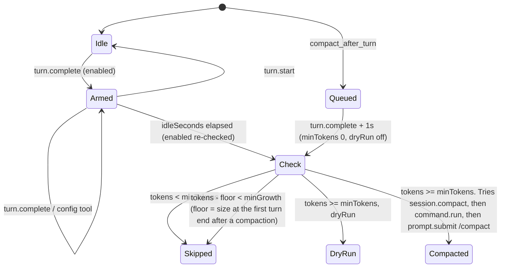

# Agent guide

Working rules (commits, tests first, layout) are in [AGENTS.md](../../AGENTS.md). This page is the model of the code.

## Purpose

Compact the main conversation after `idleSeconds` (1200) of quiet when the context is at least `minTokens` (120000), before the prompt cache goes cold. Claude Code's own idle compaction (~54 min, 200k) is off in cloud sessions; this mod covers them.

## Architecture

```
Claude Code events ──> register.ts ──> core.ts (IdleCompact) ──> config.ts (pure)
   tool.run ─────────>  tools.ts           │
                                           v
                     infra.ts Nullables: Clock Store Files Ui Host
                         create($)  -> real engine
                         createNull -> stubs + trackOutput()
```

- **Wiring** `register.ts`: one line per hook, `app.use(engine($)).<method>()`. No logic. `tools.ts`: tool schemas only.
- **Core** `core.ts`: timer state, the size gate, the compaction fallbacks, announcements, status. `config.ts`: defaults, `pick`, `merge`, project-file parsing, legacy migration. Pure.
- **Infra** `infra.ts`: thin wrappers over `$`. `createNull(...)` takes configured responses (a value repeats, a list is consumed, `{ error }` throws). Writes are recorded via `trackOutput()`. Nulled `Clock` has `advance(ms)`.
- New behavior goes in core/config with a test. New I/O goes in a new wrapper with `create` and `createNull`.

## Config layers

`resolve()` = `merge(userConfig, projectFile, live)` over `DEFAULTS`, field by field; `pick` drops unknown keys and wrong types.

| Layer | Source | Notes |
| --- | --- | --- |
| defaults | `DEFAULTS` in config.ts | |
| userConfig | plugin options | `""` counts as unset |
| projectFile | `.claude/idle-compact.json` | re-read at every arm and fire; problems go to `status.configError` |
| live | `$.store` key `overrides` | set by the `config` tool; `reset: true` clears only this; 0.5.x `config` key migrated once |

## Timer lifecycle

Only the main loop counts (`agentId === undefined`); subagent turns are ignored.



Each outcome lands in `status.lastOutcome`; failures in `status.lastErrors`. A compaction announces per `announce` (log is delayed 2 s, past the redraw); `afterPrompt` submits a wake-up message 4 s later.

## Testing

```sh
claude plugin validate .
claude plugin test .        # tests/*.test.ts, in the hooks sandbox (no Node, fs or network)
```

- `tests/core.test.ts`, `tests/config.test.ts`: the real `IdleCompact.createNull({ tokens, files, store, userConfig })`; drive with `onTurnComplete(undefined)`, `clock.advance(ms)`; assert on `status` and tracked `host`/`ui`/`store` output.
- `tests/plugin.test.ts`: thin integration through the test `$`, `mock.clock`, `mock.store`.
- Import pure modules without `.ts` (`'../hooks/core'`).

## Docs

Human docs and diagrams: [docs/humans/](../humans/README.md). Diagram sources are small text files; regenerate with the scripts in [docs/humans/gen/](../humans/gen/README.md) and [docs/tools/](../tools/README.md).
