# marble-beta preview

Rendered with our own Mermaid build of `feature/marble-diagram` (mermaid sha e3e51dba, `packages/mermaid/dist/mermaid.min.js`) in headless Chromium via Playwright, deviceScaleFactor 2, cropped to the SVG. Default theme unless the source says otherwise; the two `extra-` images show the switchMap example in the dark theme and the hand-drawn look.

## should-render-a-simple-marble-diagram

Source: `e2e/diagrams/marble/pr-check/should-render-a-simple-marble-diagram.mmd`

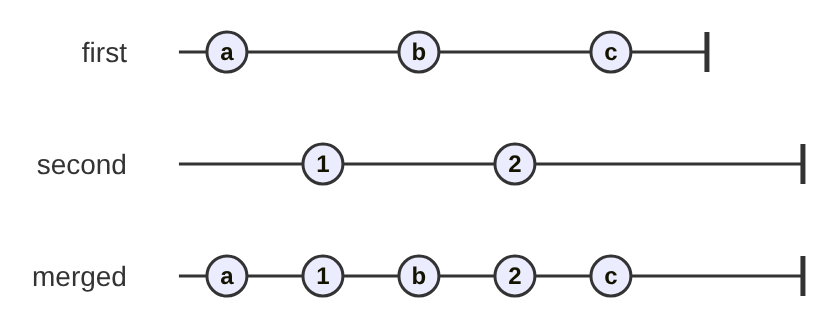

```mermaid
---
description: >-
  Baseline marble diagram: merge of two lanes of unlabelled events with
  completions, verifying the core marble-beta lane syntax and the shared time
  origin.
---
marble-beta
  first  : -a---b---c-|
  second : ---1---2-----|
  merged : -a-1-b-2-c---|
```

## should-render-marble-errors-and-time-breaks

Source: `e2e/diagrams/marble/pr-check/should-render-marble-errors-and-time-breaks.mmd`

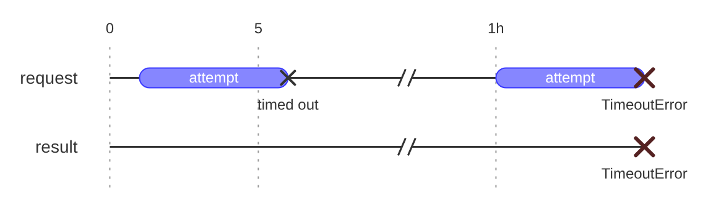

```mermaid
---
description: >-
  Marble diagram with an error terminating a lane, a cancelled attempt, and a
  "/" time break drawn across every active lane and the axis: timeout(5)
  followed by one retry after an hour.
---
marble-beta
  axis    : 0    5    /  1h
  request : -[====x---/--[====#
  result  : ----------/-------#
  label = "attempt"
  label x "timed out"
  label # "TimeoutError"
```

## should-render-marble-spans-cancellations-and-labels

Source: `e2e/diagrams/marble/pr-check/should-render-marble-spans-cancellations-and-labels.mmd`


```mermaid
---
description: >-
  Marble diagram with a title, an axis, quoted lane names, bracketed spans that
  are cancelled or closed, and labels that take palette colors: switchMap
  cancelling a search that is still in flight.
---
marble-beta
  title switchMap: a new search cancels the one in flight
  axis       : 0    5    10   15
  input      : -a-----b--c--------|
  "search a" :  [=====x
  "search b" :        [==x
  "search c" :           [=====]
  output     : ----------------r--|
  label = "request"
  label x "cancelled"
  label r "results for c"
```

## should-render-marble-hand-drawn

Source: `e2e/diagrams/marble/nightly-check/should-render-marble-hand-drawn.mmd`

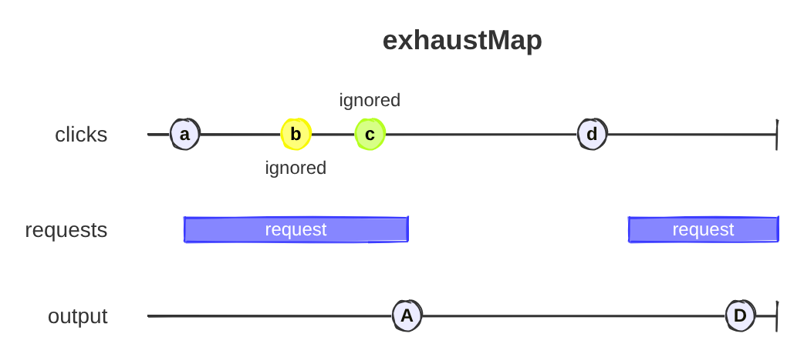

```mermaid
---
description: >-
  Marble diagram in hand-drawn look, drawing lanes, marbles and spans through
  rough.js with a fixed seed: exhaustMap ignoring clicks while a request is in
  flight.
config:
  look: handDrawn
  handDrawnSeed: 1
---
marble-beta
  title exhaustMap
  clicks   : -a--b-c-----d----|
  requests :  [=====]     [===]
  output   : -------A--------D|
  label = "request"
  label b "ignored"
  label c "ignored"
```

## should-render-marble-in-the-dark-theme

Source: `e2e/diagrams/marble/nightly-check/should-render-marble-in-the-dark-theme.mmd`

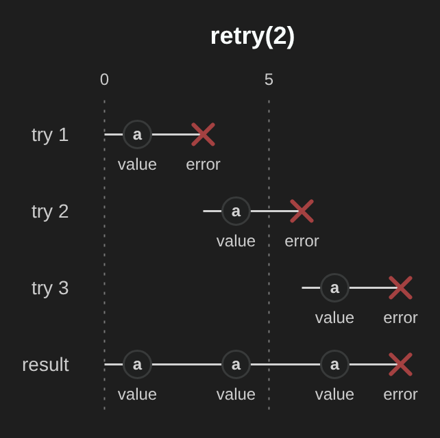

```mermaid
---
description: >-
  Marble diagram under the dark theme, checking that every marble color comes
  from theme variables rather than hardcoded values: retry(2) resubscribing to
  a source that errors.
config:
  theme: dark
---
marble-beta
  title retry(2)
  axis    : 0    5
  "try 1" : -a-#
  "try 2" :    -a-#
  "try 3" :       -a-#
  result  : -a--a--a-#
  label a "value"
  label # "error"
```

## should-render-marble-with-accessibility-directives

Source: `e2e/diagrams/marble/nightly-check/should-render-marble-with-accessibility-directives.mmd`

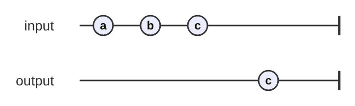

```mermaid
---
description: >-
  Marble diagram carrying accTitle and accDescr, which must not affect layout.
---
marble-beta
  accTitle: debounceTime(3)
  accDescr: Keystrokes a, b and c arrive close together, so only c is emitted, three ticks after it.
  input  : -a-b-c-----|
  output : --------c--|
```

## should-render-marble-with-config-and-theme-overrides

Source: `e2e/diagrams/marble/nightly-check/should-render-marble-with-config-and-theme-overrides.mmd`

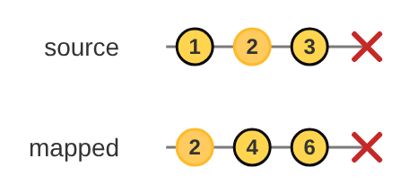

```mermaid
---
description: >-
  Marble diagram with narrow columns, event labels turned off, and theme
  variable overrides for the lane, event and error colors.
config:
  theme: base
  themeVariables:
    marbleLaneColor: '#7a7a7a'
    marbleEventFill: '#ffd54f'
    marbleErrorColor: '#c62828'
  marble:
    columnWidth: 16
    showEventLabels: false
---
marble-beta
  source : -1-2-3-#
  mapped : -2-4-6-#
  label 2 "even"
```

## docs-intro-debouncetime

Source: `packages/mermaid/src/docs/syntax/marble.md`

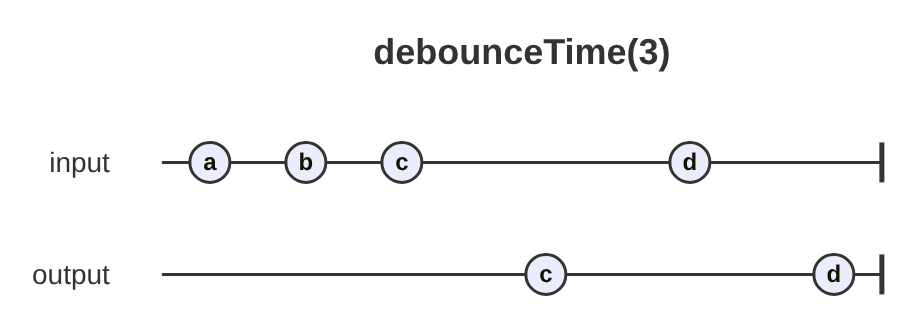

```mermaid
marble-beta
  title debounceTime(3)
  input  : -a-b-c-----d---|
  output : --------c-----d|
```

## docs-lining-up-takeuntil

Source: `packages/mermaid/src/docs/syntax/marble.md`

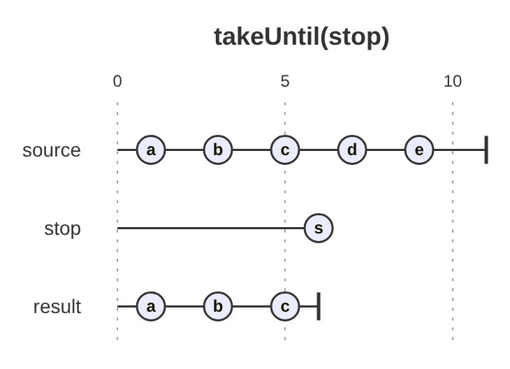

```mermaid
marble-beta
  title takeUntil(stop)
  axis   : 0    5    10
  source : -a-b-c-d-e-|
  stop   : ------s
  result : -a-b-c|
```

## docs-labels-switchmap

Source: `packages/mermaid/src/docs/syntax/marble.md`

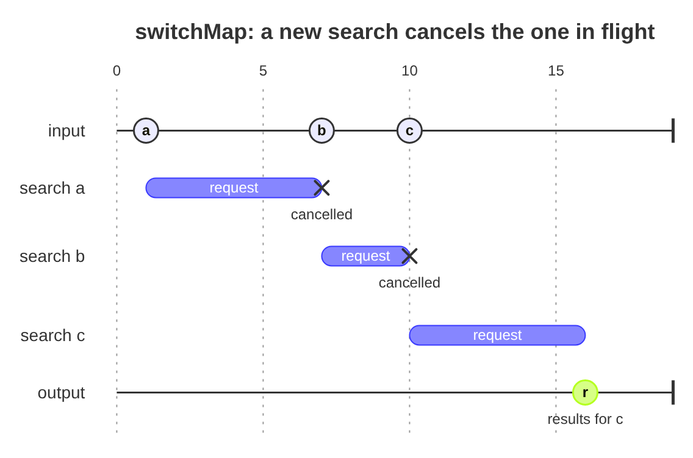

```mermaid
marble-beta
  title switchMap: a new search cancels the one in flight
  axis       : 0    5    10   15
  input      : -a-----b--c--------|
  "search a" :  [=====x
  "search b" :        [==x
  "search c" :           [=====]
  output     : ----------------r--|
  label = "request"
  label x "cancelled"
  label r "results for c"
```

## docs-breaks-timeout-retry

Source: `packages/mermaid/src/docs/syntax/marble.md`

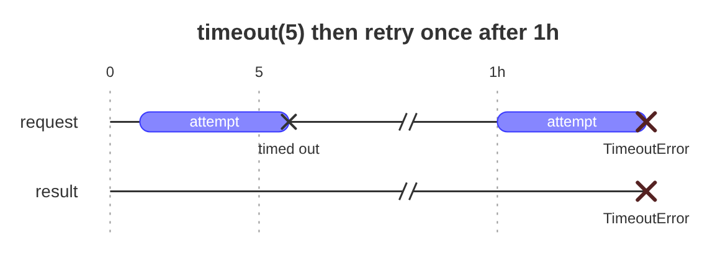

```mermaid
marble-beta
  title timeout(5) then retry once after 1h
  axis    : 0    5    /  1h
  request : -[====x---/--[====#
  result  : ----------/-------#
  label = "attempt"
  label x "timed out"
  label # "TimeoutError"
```

## docs-errors-retry

Source: `packages/mermaid/src/docs/syntax/marble.md`

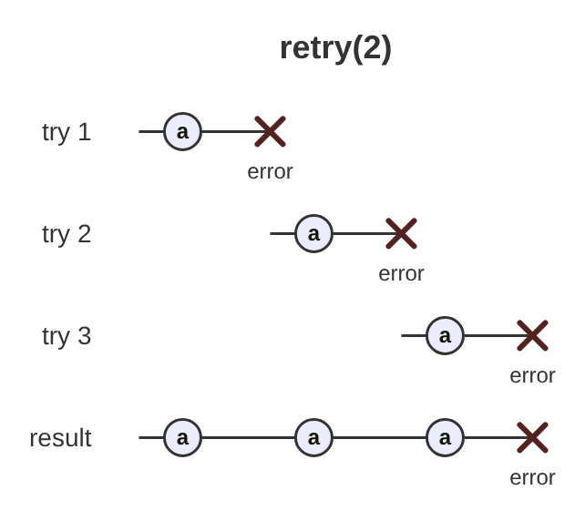

```mermaid
marble-beta
  title retry(2)
  "try 1" : -a-#
  "try 2" :    -a-#
  "try 3" :       -a-#
  result  : -a--a--a-#
  label # "error"
```

## docs-config-filter

Source: `packages/mermaid/src/docs/syntax/marble.md`

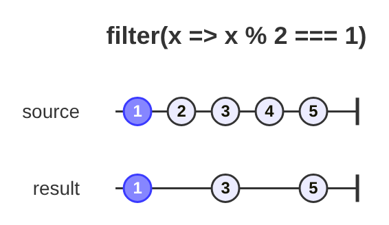

```mermaid
---
config:
  marble:
    columnWidth: 16
    showEventLabels: false
---
marble-beta
  title filter(x => x % 2 === 1)
  source : -1-2-3-4-5-|
  result : -1---3---5-|
  label 1 "odd"
```

## docs-theming-map

Source: `packages/mermaid/src/docs/syntax/marble.md`

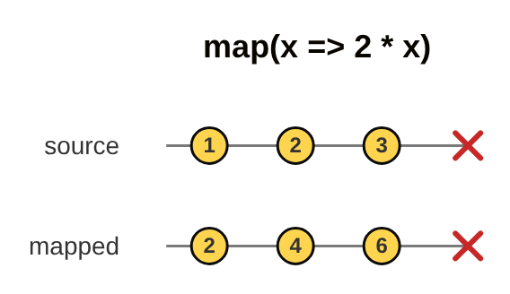

```mermaid
---
config:
  theme: base
  themeVariables:
    marbleLaneColor: '#7a7a7a'
    marbleEventFill: '#ffd54f'
    marbleErrorColor: '#c62828'
---
marble-beta
  title map(x => 2 * x)
  source : -1-2-3-#
  mapped : -2-4-6-#
```

## docs-accessibility

Source: `packages/mermaid/src/docs/syntax/marble.md`


```mermaid
marble-beta
  accTitle: Debounced search
  accDescr: debounceTime(3) - keystrokes a, b and c arrive close together, so only c is emitted, three ticks after it.
  input  : -a-b-c-----|
  output : --------c--|
```

## extra-switchmap-dark

Source: `docs switchMap example, dark theme`

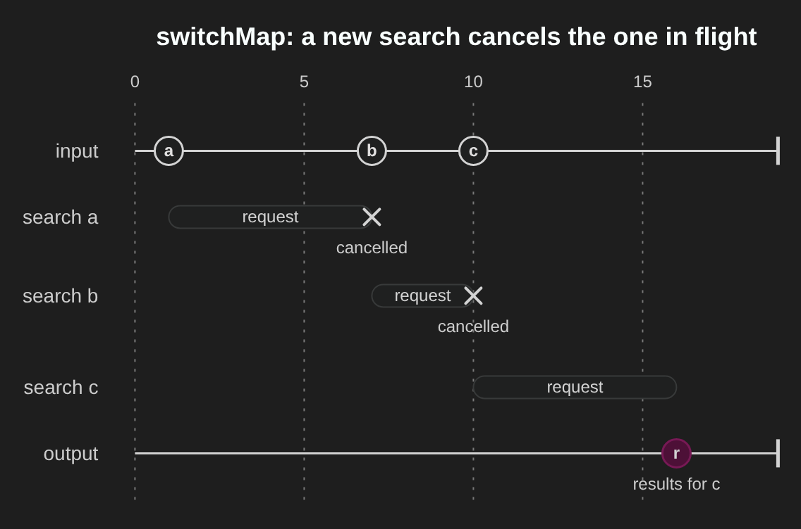

```mermaid
---
config:
  theme: dark
---
marble-beta
  title switchMap: a new search cancels the one in flight
  axis       : 0    5    10   15
  input      : -a-----b--c--------|
  "search a" :  [=====x
  "search b" :        [==x
  "search c" :           [=====]
  output     : ----------------r--|
  label = "request"
  label x "cancelled"
  label r "results for c"
```

## extra-switchmap-hand-drawn

Source: `docs switchMap example, hand-drawn look`

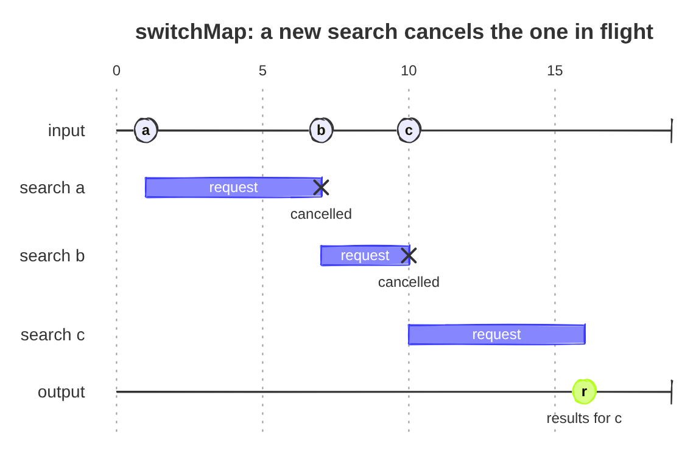

```mermaid
---
config:
  look: handDrawn
  handDrawnSeed: 1
---
marble-beta
  title switchMap: a new search cancels the one in flight
  axis       : 0    5    10   15
  input      : -a-----b--c--------|
  "search a" :  [=====x
  "search b" :        [==x
  "search c" :           [=====]
  output     : ----------------r--|
  label = "request"
  label x "cancelled"
  label r "results for c"
```
